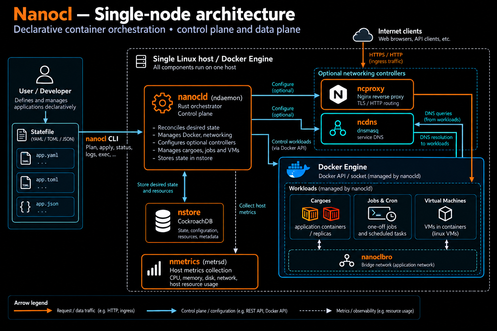

<div align="center">
  
  <h1>Nanocl</h1>
  <p><strong>Containers and virtual machines. One declarative workflow.</strong></p>
  <p>Define your workloads, networking, and secrets in a Statefile.<br />Deploy and manage them on infrastructure you control.</p>
  <p>
    <a href="#quick-start"><strong>Quick start</strong></a> ·
    <a href="https://docs.next-hat.com/guides/nanocl/overview">Documentation</a> ·
    <a href="https://nr.next-hat.com">Registry</a> ·
    <a href="./examples">Examples</a> ·
    <a href="https://discord.gg/WV4Aac8uZg">Discord</a>
  </p>

[](https://github.com/next-hat/nanocl/actions/workflows/tests.yml)
[](https://github.com/next-hat/nanocl/actions/workflows/clippy.yml)
[](https://codecov.io/gh/next-hat/nanocl)
[](#license)

</div>

**Nanocl is an open-source container and virtual machine orchestrator written in Rust.** It brings application containers, VMs, jobs, routing, and secrets into one CLI and a declarative configuration format, with Docker as its container runtime.

Use it for self-hosted applications, homelab services, or development environments where you want to keep deployment configuration in Git and operate your own infrastructure.

## Why Nanocl?

- **Describe the whole deployment.** Keep workloads, proxy rules, and secrets together in YAML, TOML, or JSON Statefiles. Apply changes with `nanocl state apply`.
- **Bring your container images.** Group named application containers into a Cargo, with ordered init containers and a replica count.
- **Go beyond containers.** Manage virtual machines, one-off jobs, and scheduled tasks through the same CLI.
- **Connect your services.** Configure HTTP/TCP routing, TLS, and service DNS through the `ncproxy` and `ncdns` controllers.
- **Reuse your configuration.** Statefile arguments, templates, and SubStates let you adapt deployments across environments and compose larger applications.

Nanocl uses its own API and Statefile format. Start with the single-node workflow below, then explore the [concepts and architecture][overview].

**Like the direction? Give Nanocl a ⭐ to bookmark it and help others discover the project.**

## Quick start

Deploy an NGINX web server and open it in your browser. This example targets the **v0.18 API** and uses a local Nanocl installation with Docker running and port **8080** available.

### 1. Install Nanocl

On **Linux or macOS**, install the CLI:

```sh
curl -fsSL https://download.next-hat.com/scripts/get-nanocl.sh | sh
```

Open a new terminal and complete the socket-access setup in the [post-installation guide][post_install]. Then install the Nanocl components:

```sh
nanocl install
```

For platform requirements and other installation methods, see the [installation guide][install]. Windows users should follow the [Windows guide][windows_install]; native Windows support is experimental and WSL is recommended.

### 2. Describe your application

Save this as `Statefile.yml`:

```yaml
ApiVersion: v0.18
Namespace: global

Cargoes:
  - Name: hello-nanocl
    PortBindings:
      "80/tcp":
        - HostIp: "127.0.0.1"
          HostPort: "8080"
    Containers:
      - Name: web
        Image: docker.io/library/nginx:alpine
```

A **Cargo** describes a group of application containers. This one runs NGINX and publishes its HTTP port on your machine's loopback address.

### 3. Deploy and open it

```sh
nanocl state apply -s Statefile.yml
nanocl cargo ls --namespace global
```

Once the container is running, open **[http://127.0.0.1:8080](http://127.0.0.1:8080)**. You should see the NGINX welcome page. You can also check the response and view the logs:

```sh
curl http://127.0.0.1:8080
nanocl cargo logs global.hello-nanocl
```

Existing Cargoes and VMs are addressed as `namespace.name`, such as `global.hello-nanocl`. To change this deployment, edit the Statefile and run `nanocl state apply` again.

### 4. Clean up

```sh
nanocl state rm -s Statefile.yml
```

**Next:** follow the [getting-started guide][get_started] or explore the examples below.

## Build something useful

**Start with a real application.** The [Nanocl Registry][registry] is a collection of ready-to-use Statefiles and real-world deployment examples. Browse the catalog, choose a deployment, and follow its instructions to adapt it to your infrastructure.

Try [Uptime Kuma](https://nr.next-hat.com/v0.18/uptime-kuma) for monitoring, [Jellyfin](https://nr.next-hat.com/v0.18/jellyfin) for a media server, or [Vaultwarden](https://nr.next-hat.com/v0.18/vaultwarden) for password management.

| You want to… | Start here |
| --- | --- |
| Route a domain to your application | [Proxy rule example](./examples/deploy_example.yml) |
| Configure HTTPS | [TLS deployment example](./examples/deploy_ssl.yml) |
| Run a scheduled task | [Cron job example](./examples/cron_job_example.yml) |
| Run a virtual machine | [VM Statefile](./examples/vm_example.yml) · [VM command reference](./doc/man/nanocl-vm-create.md) |
| Pass environment secrets to containers | [Deployment with environment secrets](./examples/deploy_secrets.yml) |
| Reuse deployment configuration | [Statefile arguments](./examples/deploy_args_example.yml) · [SubStates](./examples/sub_state.yml) |

Examples declare their own `ApiVersion`; check it against your installed version and supply any required domain, certificate, or VM image.

Browse [all examples](./examples), the [CLI reference][cli_reference], or the [daemon API reference][api_reference].

## How it works

The `nanocl` CLI sends requests to `nanocld`, which manages workloads through Docker and stores their configuration in `nstore`. Networking controllers provide proxy and DNS configuration.



| Component | Role |
| --- | --- |
| `nanocl` | CLI for deploying and managing workloads |
| `nanocld` (`ndaemon`) | REST API and orchestration daemon |
| `nstore` | Persistent cluster state in CockroachDB |
| `nmetrics` | Resource usage collection |
| `ncproxy` | Proxy controller with an embedded NGINX data plane |
| `ncdns` | DNS controller with an embedded dnsmasq data plane |

## Project status

Nanocl is actively developed. This repository's `nightly` branch includes work for **v0.19**; the quick start above uses the **v0.18** configuration format. Check the [releases][releases] and [changelog](./bin/nanocl/changelog.md) for version-specific changes.

Have a use case, a rough edge, or a feature idea? [Open an issue][issues] or [join Discord][discord] and help shape what comes next.

## Contribute and support

Bug reports, documentation improvements, examples, and code contributions are all welcome. The [contribution guide](./CONTRIBUTING.md) explains how to set up a development environment; the [Code of Conduct](./CODE_OF_CONDUCT.md) applies to our community.

- **Build with us:** [report a bug or suggest a feature][issues], or contribute to the [documentation][docs_repository].
- **Talk with us:** get help and share what you are building on [Discord][discord].
- **Fund development:** support the project through [GitHub Sponsors](https://github.com/sponsors/next-hat).
- **Help people find Nanocl:** star the repository or share it with someone building their own infrastructure.

Report vulnerabilities privately using the [security policy](./SECURITY.md).

## License

Dual licensed under [MIT](./LICENSE-MIT) or [Apache 2.0](./LICENSE-APACHE), at your option.

[registry]: https://nr.next-hat.com
[overview]: https://docs.next-hat.com/guides/nanocl/overview
[install]: https://docs.next-hat.com/manuals/nanocl/install/overview
[windows_install]: https://docs.next-hat.com/manuals/nanocl/install/windows
[post_install]: https://docs.next-hat.com/manuals/nanocl/install/post-installation
[get_started]: https://docs.next-hat.com/guides/nanocl/get-started/orientation-and-setup
[cli_reference]: https://docs.next-hat.com/references/nanocl/cli
[api_reference]: https://docs.next-hat.com/references/nanocl/daemon/overview
[releases]: https://github.com/next-hat/nanocl/releases
[issues]: https://github.com/next-hat/nanocl/issues
[discord]: https://discord.gg/WV4Aac8uZg
[docs_repository]: https://github.com/next-hat/documentation
