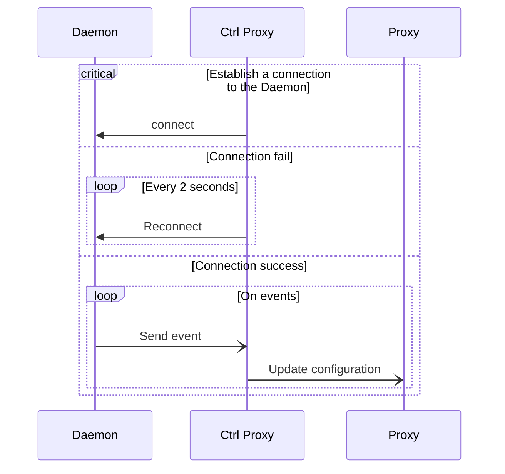

<div align="center">
  
  <h1>Nanocl Controller Proxy</h1>
  <p>

[](https://github.com/next-hat/nanocl)
[](https://github.com/next-hat/nanocl)
[](https://discord.gg/WV4Aac8uZg)

  </p>

  <p>

[](https://github.com/next-hat/nanocl/actions/workflows/tests.yml)
[](https://github.com/next-hat/nanocl/actions/workflows/clippy.yml)

  </p>

  <p>

[](https://codecov.io/gh/next-hat/nanocl)

  </p>

</div>

The official [nanocl](https://github.com/next-hat/nanocl) controller proxy build on top of nginx.

This microservice watch event sent by the nanocl daemon to generate nginx config file to enable exposition of your cargo.

## Architecture



The controller proxy will watch for events:

- Resource type `ncproxy.io/rule`:
  - Creation, Update, Suppresion
- Cargo,Vm:
  - Creation, Update, Suppression

## Startup fencing and upgrading

ncproxy uses advisory locks in `/run` and its state directory to serialize
controllers and nginx starts. nginx must inherit both startup-lock file
descriptors; ncproxy verifies that the master holds them before treating it as
managed. These files must not be removed or replaced while either process is
running. The state directory must be owned by ncproxy's user and must not be
writable by group or other users. The `/run` and state-directory paths must
have trusted, stable ancestry. This protocol cannot fence older versions or
other programs that ignore the locks.

An existing installation needs a one-time migration because an older nginx
could still be starting without a PID or listening socket. A launch, reload or
configuration validation that fails or is interrupted can leave a pending
marker; ncproxy fails closed until an operator resolves that ambiguity.
Startup/configuration errors now prevent ncproxy from starting, rather than
continuing with background retries.

For migration or recovery, first stop ncproxy and **all** nginx instances and
launchers that can use the same state directory or `/run/nginx.pid`, including
instances in other containers sharing either path. Prevent their automatic
restart and verify that none can still bind the socket or read the config.
After verifying that no such process remains, run the installed ncproxy binary
as the ncproxy user in its `/run` mount namespace, replacing the example
state directory with the actual one:

```sh
ncproxy --state-dir /var/lib/nanocl/proxy --recover-nginx-fences --acknowledge-nginx-stopped
```

This command takes the controller and startup locks, preserves their inodes,
and synchronizes the markers before releasing the locks. It checks the PID
file and rejects unsafe lock or pending files. The acknowledgement is an
operator assertion: the command cannot establish that an older launcher in
another namespace is stopped. It does not remove or alter nginx configuration.
If `/run/nginx.pid` is empty, malformed, or points to an unrelated process,
recovery stops. Investigate the PID file and process ownership first; remove a
stale PID file only after verifying that all relevant nginx processes and
launchers are stopped, then retry the command.
Fence files must be regular, singly linked files owned by ncproxy with mode
0600. The global fence and pending paths are `/run/ncproxy-nginx.fence` and
`/run/ncproxy-nginx.pending`; the state counterparts are
`<state-dir>/.ncproxy-nginx.fence` and `<state-dir>/.ncproxy-nginx.pending`.
The controller files are `/run/ncproxy-controller.lock` and
`<state-dir>/.ncproxy-controller.lock`.

Start ncproxy only after recovery is complete. It checks the health socket and
removes it only if disconnected. If a lock is busy, investigate its owner; do
not delete lock files to bypass the check.

## Access logs

Access logging is disabled by default. Opt in for a cargo or VM target with
`Target.EnableLogging: true` in an `ncproxy.io/rule`. Omission or `false` keeps
logging disabled. This replaces the old `Target.DisableLogging` option.

```yaml
Target:
  Key: my-service.global.c
  Port: 80
  EnableLogging: true
```

Nginx writes HTTP access logs to `<state-dir>/log/access.log` in a combined-log
layout suitable for Fail2ban filters. The request contains the path without the
query string; user and Referer fields are `-`, and request bodies are omitted.
TCP/UDP session logs go to `<state-dir>/log/stream.log` using `stream_basic`.
Set Fail2ban's `logpath` to the corresponding file in the mounted state directory.

Nginx error logs remain enabled at `<state-dir>/log/error.log` for outage
diagnosis. They can still include full request URLs and Referer headers.
ncproxy no longer watches access-log files, parses JSON log records, or sends
HTTP/stream access metrics to nanocld.
